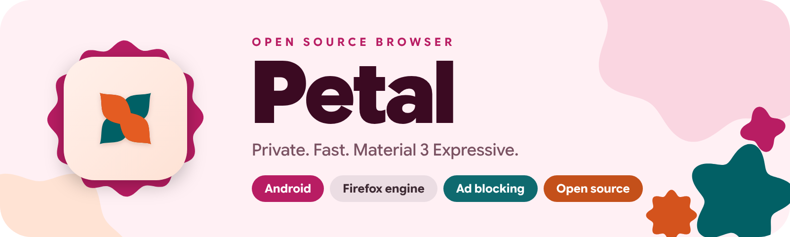

<div align="center">



<br><br>

# Petal

**An open-source Android browser on Firefox's GeckoView engine, with a Material 3 Expressive interface.**

<br>

<p align="center">
  <a href="https://play.google.com/store/apps/details?id=com.petal.browser"><picture><source media="(prefers-color-scheme: dark)" srcset="docs/readme/dark/btn-playstore.svg"></picture></a>
  <a href="https://github.com/shreyagarwal72/petal/releases/latest"><picture><source media="(prefers-color-scheme: dark)" srcset="docs/readme/dark/btn-download.svg"></picture></a>
  <a href="https://my-petal-browser.vercel.app/"><picture><source media="(prefers-color-scheme: dark)" srcset="docs/readme/dark/btn-website.svg"></picture></a>
  <a href="https://github.com/shreyagarwal72/petal"><picture><source media="(prefers-color-scheme: dark)" srcset="docs/readme/dark/btn-github.svg"></picture></a>
  <a href="https://t.me/championworkspace"><picture><source media="(prefers-color-scheme: dark)" srcset="docs/readme/dark/btn-telegram.svg"></picture></a>
  <a href="https://github.com/shreyagarwal72/petal/issues"><picture><source media="(prefers-color-scheme: dark)" srcset="docs/readme/dark/btn-issues.svg"></picture></a>
</p>

<p align="center">
  <picture><source media="(prefers-color-scheme: dark)" srcset="docs/readme/dark/badge-gecko.svg"></picture>
  <picture><source media="(prefers-color-scheme: dark)" srcset="docs/readme/dark/badge-m3e.svg"></picture>
  <picture><source media="(prefers-color-scheme: dark)" srcset="docs/readme/dark/badge-extensions.svg"></picture>
  <picture><source media="(prefers-color-scheme: dark)" srcset="docs/readme/dark/badge-android.svg"></picture>
  <picture><source media="(prefers-color-scheme: dark)" srcset="docs/readme/dark/badge-kotlin.svg"></picture>
  <picture><source media="(prefers-color-scheme: dark)" srcset="docs/readme/dark/badge-gpl.svg"></picture>
  <a href="https://play.google.com/store/apps/details?id=com.petal.browser"><picture><source media="(prefers-color-scheme: dark)" srcset="docs/readme/dark/badge-playstore.svg"></picture></a>
  <a href="https://my-petal-browser.vercel.app/"><picture><source media="(prefers-color-scheme: dark)" srcset="docs/readme/dark/badge-website.svg"></picture></a>
  <picture><source media="(prefers-color-scheme: dark)" srcset="docs/readme/dark/badge-prs.svg"></picture>
</p>

<br>

[Docs](https://my-petal-browser.vercel.app/docs) · [Changelog](CHANGELOG.md) · [Features](#features) · [Screenshots](#screenshots) · [Quick Facts](#quick-facts) · [Permissions](#permissions) · [Build](#building) · [FAQ](FAQs.md)

</div>

<br>

Petal is an open-source Android browser built on Mozilla's GeckoView engine and Mozilla Android Components, not the system WebView. Pages render like Firefox, Firefox add-ons work, and a built-in blocker cancels ad and tracker requests before they load. The interface is 100% Kotlin and Jetpack Compose in Material 3 Expressive.

**Latest release: v4.8.0** · GeckoView 159.0 · Android Components 159.0.1 · [Changelog](CHANGELOG.md)

<br>

<p align="center">
  <picture>
    <source media="(prefers-color-scheme: dark)" srcset="docs/readme/divider-dark.svg">
    
  </picture>
</p>

##  Quick Facts

<table width="100%">
<thead><tr><th align="left" width="28%">Attribute</th><th align="left">Details</th></tr></thead>
<tbody>
<tr><td><b>App</b></td><td>Petal Browser (<code>com.petal.browser</code>), latest release v4.8.0</td></tr>
<tr><td><b>Platform</b></td><td>Android 8.0 and above (API 26+), compile and target SDK 36</td></tr>
<tr><td><b>Engine</b></td><td>Mozilla GeckoView 159.0 with Mozilla Android Components 159.0.1</td></tr>
<tr><td><b>Language</b></td><td>100% Kotlin 2.4 (about 660 source files, no Java), JVM 17 target</td></tr>
<tr><td><b>UI</b></td><td>Jetpack Compose (BOM 2026.09) and Material 3 Expressive (<code>material3 1.5.0-alpha22</code>)</td></tr>
<tr><td><b>Ad &amp; tracker blocking</b></td><td>Built-in <code>petal_network_blocker</code> WebExtension with EasyList, uBlock uAssets and Hagezi lists, plus Gecko Enhanced Tracking Protection (Strict by default)</td></tr>
<tr><td><b>Extensions</b></td><td>Firefox WebExtensions: add-on manager, AMO, .xpi import, 10 built-in add-ons</td></tr>
<tr><td><b>Sync</b></td><td>Optional Firefox Account (bookmarks, history, passwords, tabs, Send Tab)</td></tr>
<tr><td><b>Builds</b></td><td>GitHub (in-app updater), Google Play, F-Droid (no ads, no Google code)</td></tr>
<tr><td><b>Languages</b></td><td>28 translations</td></tr>
<tr><td><b>License</b></td><td>GNU GPL v3.0</td></tr>
</tbody>
</table>

<p align="center">
  <picture>
    <source media="(prefers-color-scheme: dark)" srcset="docs/readme/divider-dark.svg">
    
  </picture>
</p>

##  Screenshots

<div align="center">
  
  
  
  
  
</div>

<p align="center">
  <picture>
    <source media="(prefers-color-scheme: dark)" srcset="docs/readme/divider-dark.svg">
    
  </picture>
</p>

##  Features

<table width="100%">
<tr>
<td width="50%" valign="top">
<h4> Firefox engine</h4>
GeckoView 159 and Mozilla Android Components handle rendering, tabs, downloads, prompts and sync. One active tab is mounted at a time; background tabs live in <code>BrowserStore</code>.
</td>
<td width="50%" valign="top">
<h4> Built-in blocking</h4>
A bundled WebExtension cancels ad and tracker requests before they are sent, with early cosmetic filtering. A 7-section Privacy &amp; Security page covers HTTPS-only, DNS-over-HTTPS, fingerprinting and more.
</td>
</tr>
<tr>
<td width="50%" valign="top">
<h4> Material 3 Expressive</h4>
35 expressive shapes, spring motion, predictive back, dynamic colour from your wallpaper, a true-black AMOLED theme and an optional Liquid Glass look.
</td>
<td width="50%" valign="top">
<h4> Tab organisation</h4>
Workspaces, collapsible tab folders, pinned tabs and a Glance peek sheet, with a Chrome-style tab grid transition.
</td>
</tr>
<tr>
<td width="50%" valign="top">
<h4> Downloads &amp; media</h4>
Downloads use Mozilla's download service, so cookies and private mode carry over. Media3 ExoPlayer with picture-in-picture, a reader mode with read-aloud, and a yt-dlp based media grabber.
</td>
<td width="50%" valign="top">
<h4> Sync &amp; optional AI</h4>
Sign in with a Firefox Account to sync and send tabs. An optional assistant uses your own key for Gemini, OpenAI, Anthropic, Groq or a local Ollama.
</td>
</tr>
</table>

<p align="center">
  <picture>
    <source media="(prefers-color-scheme: dark)" srcset="docs/readme/divider-dark.svg">
    
  </picture>
</p>

##  Permissions

Petal asks only when a feature is actively invoked:

| Permission | Purpose |
| :--- | :--- |
| `INTERNET` & `ACCESS_NETWORK_STATE` | Loading web pages and detecting connection state. |
| `CAMERA` & `RECORD_AUDIO` | Requested only when a web page prompts for camera/mic access or QR code scanning. |
| `ACCESS_FINE_LOCATION` | Optional; prompted strictly per site with granular allow/block toggles. |
| `READ_MEDIA_*` & storage | Uploading files, viewing downloaded PDFs, and local storage management. |
| `POST_NOTIFICATIONS` & foreground | Foreground services for ongoing downloads and background media playback. |
| `USE_BIOMETRIC` | Unlocking your local password safe with biometric authentication. |
| `VIBRATE` | Material 3 Expressive spring motion haptics and touch feedback. |
| `REQUEST_INSTALL_PACKAGES` | Optional built-in seamless updater for GitHub releases. |
| `SYSTEM_ALERT_WINDOW` | Optional floating island on devices running versions without Android 16 Live Updates. |

<p align="center">
  <picture>
    <source media="(prefers-color-scheme: dark)" srcset="docs/readme/divider-dark.svg">
    
  </picture>
</p>

##  Tech Stack

<table width="100%">
<thead><tr><th align="left" width="25%">Layer</th><th align="left" width="35%">Library / Tool</th><th align="left">Role</th></tr></thead>
<tbody>
<tr><td><b>Language</b></td><td>Kotlin 2.4 (Compose compiler 2.4.21)</td><td>All app code. KSP 2.3.13 for annotation processing.</td></tr>
<tr><td><b>Build</b></td><td>Android Gradle Plugin 9.4.0 · Gradle wrapper</td><td>Flavors for GitHub, Play and F-Droid, with ABI splits for arm64-v8a, armeabi-v7a, x86 and x86_64.</td></tr>
<tr><td><b>UI</b></td><td>Jetpack Compose BOM 2026.09 · Material 3 1.5.0-alpha22</td><td>Expressive components, springs and shape morphing (<code>graphics-shapes</code>), Liquid Glass via <code>backdrop</code>.</td></tr>
<tr><td><b>Engine</b></td><td>GeckoView 159.0.20261102144711</td><td>Rendering and the WebExtension runtime.</td></tr>
<tr><td><b>Browser components</b></td><td>Mozilla Android Components 159.0.1</td><td>Engine bridge, <code>BrowserStore</code>, downloads, prompts, site permissions, Firefox Accounts and sync.</td></tr>
<tr><td><b>DI &amp; navigation</b></td><td>Hilt 2.60.1 · Navigation Compose 2.10</td><td>Dependency injection and screen routing.</td></tr>
<tr><td><b>Media</b></td><td>Media3 1.11 (ExoPlayer, HLS, session) · yt-dlp library</td><td>Playback, background audio and the media grabber.</td></tr>
<tr><td><b>Storage</b></td><td>SQLite (<code>SQLiteOpenHelper</code>) · Android Keystore · Biometrics</td><td>History, bookmarks and the local password vault.</td></tr>
<tr><td><b>Optional tools</b></td><td>Shizuku API 13 · ML Kit · CameraX + ZXing</td><td>Privileged installs, on-device recognition and the QR scanner.</td></tr>
<tr><td><b>Platform</b></td><td>Min SDK 26 · Target SDK 36</td><td>Android 8.0 and newer.</td></tr>
</tbody>
</table>

<p align="center">
  <picture>
    <source media="(prefers-color-scheme: dark)" srcset="docs/readme/divider-dark.svg">
    
  </picture>
</p>

##  Architecture

Petal is a single Android app written in Kotlin. Mozilla's GeckoView renders pages, Mozilla Android Components keep tab, download and sync state in a `BrowserStore`, and Jetpack Compose draws the interface. The full write-up is in [architecture.md](architecture.md).

```mermaid
graph TD
    classDef core fill:#b81d63,stroke:#ffd9e3,stroke-width:2px,color:#ffffff
    classDef ui fill:#463647,stroke:#cfb8ce,stroke-width:1.5px,color:#fed7ff
    classDef engine fill:#224466,stroke:#78b3f0,stroke-width:1.5px,color:#e1f0ff
    classDef sec fill:#2b4c38,stroke:#85d6a4,stroke-width:1.5px,color:#e8f8ee

    Petal["Petal Browser (Kotlin)"]:::core
    Petal --> UI["Material 3 Expressive UI<br/>compose / ui"]:::ui
    Petal --> Engine["GeckoView 159 + Android Components 159.0.1<br/>engine / browser"]:::engine
    Petal --> Privacy["Privacy and sync<br/>privacy / passwords / account"]:::sec
    Petal --> Media["Media and downloads<br/>media / download"]:::ui

    UI --> U1["Shape morphing and spring motion"]:::ui
    UI --> U2["Liquid Glass, predictive back"]:::ui
    UI --> U3["Tab grid, workspaces, folders"]:::ui

    Engine --> E1["WebExtension runtime and add-on manager"]:::engine
    Engine --> E2["BrowserStore and PetalTabViewController"]:::engine
    Engine --> E3["Total Cookie Protection, Strict ETP"]:::engine

    Privacy --> P1["petal_network_blocker WebExtension"]:::sec
    Privacy --> P2["Biometric password vault"]:::sec
    Privacy --> P3["Firefox Account sync"]:::sec

    Media --> M1["Media3 ExoPlayer, PiP"]:::ui
    Media --> M2["Mozilla AbstractFetchDownloadService"]:::ui
    Media --> M3["yt-dlp media grabber"]:::ui
```



<details>
<summary><b>Package map</b></summary>
<br>

Paths are inside `app/src/main/java/com/petal/browser/` unless noted:

| Area | Package path | Responsibility |
| :--- | :--- | :--- |
| **UI components** | `ui/` | Shared Material 3 Expressive components, glass effects, theme and haptics. |
| **Screens** | `compose/` | Home, tabs, settings, downloads, PDF and image viewers, extensions, AI. |
| **Engine** | `engine/` `browser/` | GeckoView runtime, `PetalTabViewController`, store bridge, cookie bridge. |
| **Media** | `media/` | Player, picture-in-picture, playback service. |
| **Downloads** | `download/` | Download state and UI on top of Mozilla's download service. |
| **Privacy and vault** | `privacy/` `passwords/` `security/` | Blocking settings, biometric vault and app lock. |
| **Account** | `account/` | Firefox Account sign-in and sync. |
| **Built-in add-ons** | `app/src/main/assets/web_extensions/` | Ten bundled WebExtensions, including `petal_network_blocker`. |
| **Startup profile** | `baselineprofile/` (repo root) | Baseline Profile for faster cold starts. |
| **Website** | `site/` (repo root) | Static project site, changelog and docs. |

</details>

<p align="center">
  <picture>
    <source media="(prefers-color-scheme: dark)" srcset="docs/readme/divider-dark.svg">
    
  </picture>
</p>

##  Building

You need **JDK 17 or newer** and the Android SDK.

```bash
git clone https://github.com/shreyagarwal72/petal.git
cd petal

./gradlew assembleDebug      # debug APK
./gradlew assembleRelease    # release APK
```

The release APK is written to `app/build/outputs/apk/release/`. Or open the folder in Android Studio and run the `app` configuration on a device.

<p align="center">
  <picture>
    <source media="(prefers-color-scheme: dark)" srcset="docs/readme/divider-dark.svg">
    
  </picture>
</p>

##  Contributing

Bug reports, ideas and pull requests are welcome, especially for browsing reliability, interface polish, privacy and documentation. Read the [code of conduct](CODE_OF_CONDUCT.md) first, and open an issue before starting a large change. For the visual rules, start with [design.md](design.md).

<p align="center">
  <picture>
    <source media="(prefers-color-scheme: dark)" srcset="docs/readme/divider-dark.svg">
    
  </picture>
</p>

##  Credits

- **[Mozilla GeckoView](https://mozilla.github.io/geckoview/)** and Mozilla Android Components for the engine and browser components.
- **[Hagezi](https://github.com/hagezi/dns-blocklists)** and **[uBlock Origin uAssets](https://github.com/uBlockOrigin/uAssets)** for the filter lists. Their licences are in `site/assets/licenses/`.
- **[Shizuku](https://github.com/RikkaApps/Shizuku)** by RikkaApps for the optional privileged API.
- **[Material 3 Expressive](https://m3.material.io/)** for the design language.

##  License

Petal is free software under the [GNU General Public License v3.0](LICENSE.md).

<p align="center">
  Made by <strong>Vanshu Agarwal</strong> From India 🇮🇳
</p>
