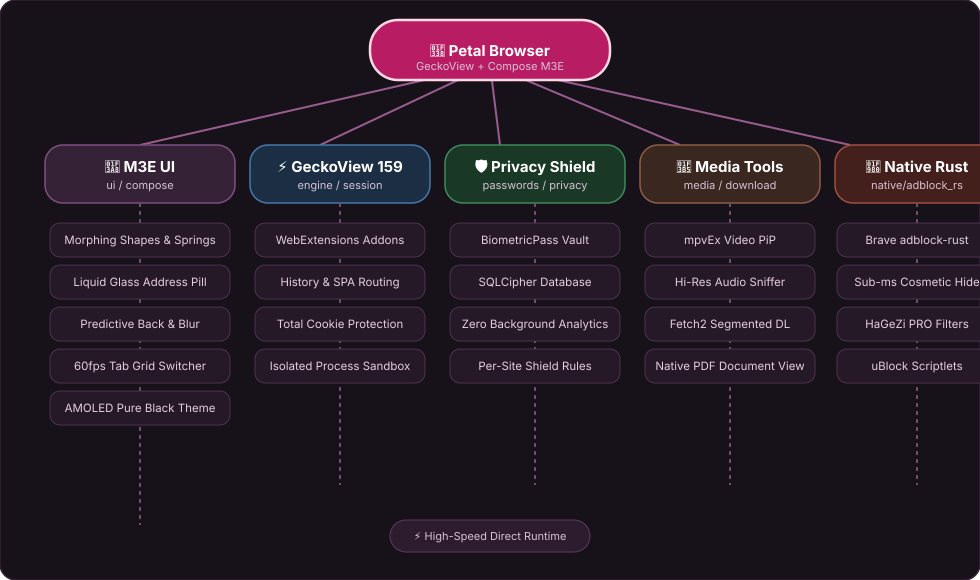

<div align="center">


<br><br>

# Petal

**A private, fast Android browser on Firefox's GeckoView engine, designed with Material 3 Expressive.**

<br>

<p align="center">
  <a href="https://play.google.com/store/apps/details?id=com.petal.browser"><picture><source media="(prefers-color-scheme: dark)" srcset="docs/readme/dark/btn-playstore.svg"></picture></a>
  <a href="https://github.com/shreyagarwal72/petal/releases/latest"><picture><source media="(prefers-color-scheme: dark)" srcset="docs/readme/dark/btn-download.svg"></picture></a>
  <a href="https://my-petal-browser.vercel.app/"><picture><source media="(prefers-color-scheme: dark)" srcset="docs/readme/dark/btn-website.svg"></picture></a>
  <a href="https://github.com/shreyagarwal72/petal"><picture><source media="(prefers-color-scheme: dark)" srcset="docs/readme/dark/btn-github.svg"></picture></a>
  <a href="https://t.me/championworkspace"><picture><source media="(prefers-color-scheme: dark)" srcset="docs/readme/dark/btn-telegram.svg"></picture></a>
  <a href="https://github.com/shreyagarwal72/petal/issues"><picture><source media="(prefers-color-scheme: dark)" srcset="docs/readme/dark/btn-issues.svg"></picture></a>
</p>

<p align="center">
  <picture><source media="(prefers-color-scheme: dark)" srcset="docs/readme/dark/badge-gecko.svg"></picture>
  <picture><source media="(prefers-color-scheme: dark)" srcset="docs/readme/dark/badge-rustadblock.svg"></picture>
  <picture><source media="(prefers-color-scheme: dark)" srcset="docs/readme/dark/badge-m3e.svg"></picture>
  <picture><source media="(prefers-color-scheme: dark)" srcset="docs/readme/dark/badge-adfree.svg"></picture>
  <picture><source media="(prefers-color-scheme: dark)" srcset="docs/readme/dark/badge-privacy.svg"></picture>
  <picture><source media="(prefers-color-scheme: dark)" srcset="docs/readme/dark/badge-extensions.svg"></picture>
  <picture><source media="(prefers-color-scheme: dark)" srcset="docs/readme/dark/badge-android.svg"></picture>
  <picture><source media="(prefers-color-scheme: dark)" srcset="docs/readme/dark/badge-kotlin.svg"></picture>
  <picture><source media="(prefers-color-scheme: dark)" srcset="docs/readme/dark/badge-gpl.svg"></picture>
  <a href="https://play.google.com/store/apps/details?id=com.petal.browser"><picture><source media="(prefers-color-scheme: dark)" srcset="docs/readme/dark/badge-playstore.svg"></picture></a>
  <a href="https://my-petal-browser.vercel.app/"><picture><source media="(prefers-color-scheme: dark)" srcset="docs/readme/dark/badge-website.svg"></picture></a>
  <picture><source media="(prefers-color-scheme: dark)" srcset="docs/readme/dark/badge-prs.svg"></picture>
</p>

<br>

[Docs](https://my-petal-browser.vercel.app/docs) · [Features](#features) · [Screenshots](#screenshots) · [Quick Facts](#quick-facts) · [Permissions](#permissions) · [Build](#build-it-yourself) · [FAQ](FAQs.md)

</div>

<br>

Petal is a private, open-source browser for Android built from the ground up on Mozilla's GeckoView engine instead of standard Chromium WebView. It blocks ads, tracking beacons, and crypto miners before they execute, combined with fluid Material 3 Expressive spring physics, adaptive dynamic coloring, and deep Firefox add-on integration.

<br>

<p align="center">
  <picture>
    <source media="(prefers-color-scheme: dark)" srcset="docs/readme/divider-dark.svg">
    
  </picture>
</p>

##  Quick Facts

<table width="100%">
<thead><tr><th align="left" width="28%">Attribute</th><th align="left">Details</th></tr></thead>
<tbody>
<tr><td><b>App Name</b></td><td>Petal Browser</td></tr>
<tr><td><b>Platform</b></td><td>Android 8.0 and above (API 26+, target API 36)</td></tr>
<tr><td><b>Engine</b></td><td>Mozilla GeckoView 159 (Independent standards engine)</td></tr>
<tr><td><b>Ad Blocking</b></td><td>High-performance native Rust engine (Brave <code>adblock-rust</code>) + uBlock & Hagezi lists</td></tr>
<tr><td><b>UI System</b></td><td>Jetpack Compose & Material 3 Expressive (Spring physics, morphing shapes, dynamic color)</td></tr>
<tr><td><b>Extensions</b></td><td>Firefox WebExtensions / Add-ons support</td></tr>
<tr><td><b>Privacy</b></td><td>Zero accounts, local biometric password vault, per-site shield, zero telemetry</td></tr>
<tr><td><b>AI Assistant</b></td><td>Optional BYOK (Gemini, OpenAI, Anthropic, Groq, Ollama)</td></tr>
<tr><td><b>License</b></td><td>GNU GPL v3.0</td></tr>
</tbody>
</table>

<p align="center">
  <picture>
    <source media="(prefers-color-scheme: dark)" srcset="docs/readme/divider-dark.svg">
    
  </picture>
</p>

##  Screenshots

<div align="center">
  
  
  
  
  
</div>

<p align="center">
  <picture>
    <source media="(prefers-color-scheme: dark)" srcset="docs/readme/divider-dark.svg">
    
  </picture>
</p>

##  Features

<table width="100%">
<tr>
<td width="50%" valign="top">
<h4> Firefox GeckoView Engine</h4>
Independent from Android WebView. Complete Gecko 159 web standards, CSS grids, and extensions runtime.
</td>
<td width="50%" valign="top">
<h4> Native Rust Adblocking</h4>
Powered by <code>adblock-rust</code> compiled via NDK. Real-time cosmetic hiding and script blocking before download.
</td>
</tr>
<tr>
<td width="50%" valign="top">
<h4> Material 3 Expressive</h4>
Dynamic color extracted from wallpaper, morphing bottom pill bar, fluid spring curves, and true-black AMOLED mode.
</td>
<td width="50%" valign="top">
<h4> Hardware-Backed Privacy</h4>
BiometricPrompt-protected password vault, granular per-site tracking shield, and zero background analytics.
</td>
</tr>
<tr>
<td width="50%" valign="top">
<h4> Segmented Downloader</h4>
Multi-threaded background download manager, floating picture-in-picture media player, and native PDF viewer.
</td>
<td width="50%" valign="top">
<h4> Bring-Your-Own-Key AI</h4>
Optional on-device and cloud companion. Connect Gemini, OpenAI, Claude, or local Ollama instances to query pages.
</td>
</tr>
</table>

<p align="center">
  <picture>
    <source media="(prefers-color-scheme: dark)" srcset="docs/readme/divider-dark.svg">
    
  </picture>
</p>

##  Permissions

Petal asks only when a feature is actively invoked:

| Permission | Purpose |
| :--- | :--- |
| `INTERNET` & `ACCESS_NETWORK_STATE` | Loading web pages and detecting connection state. |
| `CAMERA` & `RECORD_AUDIO` | Requested only when a web page prompts for camera/mic access or QR code scanning. |
| `ACCESS_FINE_LOCATION` | Optional; prompted strictly per site with granular allow/block toggles. |
| `READ_MEDIA_*` & storage | Uploading files, viewing downloaded PDFs, and local storage management. |
| `POST_NOTIFICATIONS` & foreground | Foreground services for ongoing downloads and background media playback. |
| `USE_BIOMETRIC` | Unlocking your local password safe with biometric authentication. |
| `VIBRATE` | Material 3 Expressive spring motion haptics and touch feedback. |
| `REQUEST_INSTALL_PACKAGES` | Optional built-in seamless updater for GitHub releases. |
| `SYSTEM_ALERT_WINDOW` | Optional floating island on devices running versions without Android 16 Live Updates. |

<p align="center">
  <picture>
    <source media="(prefers-color-scheme: dark)" srcset="docs/readme/divider-dark.svg">
    
  </picture>
</p>

##  Tech Stack

<table width="100%">
<thead><tr><th align="left" width="25%">Layer</th><th align="left" width="35%">Library / Tool</th><th align="left">Role</th></tr></thead>
<tbody>
<tr><td><b>Language</b></td><td>Kotlin 2.x · Rust (NDK)</td><td>Expressive, null-safe app code with high-performance native adblock filtering.</td></tr>
<tr><td><b>UI System</b></td><td>Jetpack Compose · Material 3 Expressive</td><td>Dynamic container transforms, custom spring specs, and expressive motion tokens.</td></tr>
<tr><td><b>Browser Engine</b></td><td>Mozilla GeckoView 159</td><td>Independent browser engine and WebExtension runtime.</td></tr>
<tr><td><b>Ad Blocking</b></td><td><code>adblock-rust</code> (NDK JNI)</td><td>High-performance URL rule parsing and cosmetic element filtering.</td></tr>
<tr><td><b>Architecture</b></td><td>MVVM · StateFlow · Flow</td><td>Clean separation of reactive UI state and GeckoView engine events.</td></tr>
<tr><td><b>Dependency Injection</b></td><td>Dagger Hilt</td><td>Modular singleton and Android lifecycle dependency injection.</td></tr>
<tr><td><b>Storage & Vault</b></td><td>Room SQLite · SQLCipher · Biometrics</td><td>Encrypted vault for credentials, history, and bookmarks.</td></tr>
<tr><td><b>Privileged APIs</b></td><td>Shizuku API</td><td>Elevated system integration for package installs & overlays without root.</td></tr>
<tr><td><b>Platform Targets</b></td><td>Min SDK 26 (Android 8.0) · Target SDK 36</td><td>Broad compatibility from Android 8 through modern Android versions.</td></tr>
</tbody>
</table>

<p align="center">
  <picture>
    <source media="(prefers-color-scheme: dark)" srcset="docs/readme/divider-dark.svg">
    
  </picture>
</p>

##  Architecture & Codebase Mind Map

Petal is a reactive, single-app Android project built on Mozilla GeckoView with a high-performance native Rust core. Explore the architectural mind map and interactive package tree below:

<p align="center">
  
</p>

<details>
<summary><b>🗺️ View Mermaid Syntax Diagram (Click to expand)</b></summary>
<br>



</details>

<details>
<summary><b>📂 Interactive Package Directory Tree (Click to expand)</b></summary>
<br>

```mermaid
graph TD
    classDef core fill:#b81d63,stroke:#ffd9e3,stroke-width:2px,color:#ffffff,font-weight:bold
    classDef ui fill:#463647,stroke:#cfb8ce,stroke-width:1.5px,color:#fed7ff
    classDef engine fill:#224466,stroke:#78b3f0,stroke-width:1.5px,color:#e1f0ff
    classDef sec fill:#2b4c38,stroke:#85d6a4,stroke-width:1.5px,color:#e8f8ee
    classDef native fill:#5c351f,stroke:#f0a878,stroke-width:1.5px,color:#ffeedd

    Petal["🌸 Petal Browser"]:::core

    Petal --> UI["🎨 Material 3 Expressive UI<br/>ui / compose"]:::ui
    Petal --> Engine["⚡ GeckoView 159 Engine<br/>engine"]:::engine
    Petal --> Privacy["🛡️ Privacy & Security Vault<br/>passwords / privacy / sync"]:::sec
    Petal --> Media["🎵 Media & Download Manager<br/>media / download"]:::ui
    Petal --> Rust["🦀 Native Rust Adblock NDK<br/>native/adblock_rs"]:::native

    UI --> U1["Morphing Shapes & Spring Curves"]:::ui
    UI --> U2["Liquid Glass Address Pill"]:::ui
    UI --> U3["Predictive Back & Depth Blur"]:::ui
    UI --> U4["60fps Tab Grid Switcher"]:::ui

    Engine --> E1["Firefox WebExtension Runtime"]:::engine
    Engine --> E2["GeckoSession & Tab History Controller"]:::engine
    Engine --> E3["Total Cookie Protection & Sandboxing"]:::engine

    Privacy --> P1["BiometricPrompt Password Vault"]:::sec
    Privacy --> P2["SQLCipher Local Encrypted SQLite"]:::sec
    Privacy --> P3["Zero Telemetry & Per-Site Shields"]:::sec

    Media --> M1["mpvEx Floating Video PiP"]:::ui
    Media --> M2["Hi-Res Audio Player & Sniffer"]:::ui
    Media --> M3["Fetch2 Resumable Multi-thread Downloads"]:::ui

    Rust --> R1["Brave adblock-rust NDK Engine"]:::native
    Rust --> R2["Sub-millisecond Cosmetic Hiding"]:::native
    Rust --> R3["HaGeZi PRO & uBlock Network Filters"]:::native
```

Paths below are inside `app/src/main/java/com/petal/browser/` unless noted:

| Area | Package Path | Architectural Responsibility |
| :--- | :--- | :--- |
| **UI Components** | `ui/` | Shared M3E containment, glass effects, dynamic wallpaper palette, and haptics. |
| **Screens** | `compose/` | Full-screen Compose views: Home, Tab Grid, Settings, Downloads, PDF Viewer, and AI Hub. |
| **Browser Engine** | `engine/` | Mozilla GeckoView integration, WebExtensions bridge, and navigation event dispatcher. |
| **Media Player** | `media/` | Native audio/video player with PiP, media sniffer, and playback notification service. |
| **Downloads** | `download/` | Multi-threaded segmented background download manager with auto-resumption. |
| **Privacy & Vault** | `passwords/` `privacy/` | Hardware-backed biometric encrypted SQLite vault and per-site tracking defense. |
| **Account Sync** | `sync/` | Optional end-to-end encrypted Firefox Account sync engine. |
| **Native Adblock** | `native/adblock_rs/` | JNI bindings and Brave `adblock-rust` compiled via Android NDK (repo root). |
| **Startup Profile** | `baselineprofile/` | Android Baseline Profile for instant cold starts and smooth 120Hz scrolling. |
| **Project Site** | `site/` | Fast static documentation, changelog, PRD, and privacy portal. |

</details>

<p align="center">
  <picture>
    <source media="(prefers-color-scheme: dark)" srcset="docs/readme/divider-dark.svg">
    
  </picture>
</p>

##  Building

You need **JDK 17 or newer** and the Android SDK.

```bash
git clone https://github.com/shreyagarwal72/petal.git
cd petal

./gradlew assembleDebug      # debug APK
./gradlew assembleRelease    # release APK
```

The release APK is written to `app/build/outputs/apk/release/`. Or open the folder in Android Studio and run the `app` configuration on a device.

<p align="center">
  <picture>
    <source media="(prefers-color-scheme: dark)" srcset="docs/readme/divider-dark.svg">
    
  </picture>
</p>

##  Contributing

Bug reports, ideas and pull requests are welcome, especially for browsing reliability, interface polish, privacy and documentation. Read the [code of conduct](CODE_OF_CONDUCT.md) first, and open an issue before starting a large change. For the visual rules, start with [design.md](design.md).

<p align="center">
  <picture>
    <source media="(prefers-color-scheme: dark)" srcset="docs/readme/divider-dark.svg">
    
  </picture>
</p>

##  Credits

- **[Mozilla GeckoView](https://mozilla.github.io/geckoview/)** for the browser engine.
- **[adblock-rust](https://github.com/brave/adblock-rust)** by Brave (MPL-2.0) for the ad-blocking engine.
- **[Hagezi](https://github.com/hagezi/dns-blocklists)** and **[uBlock Origin uAssets](https://github.com/uBlockOrigin/uAssets)** for the filter lists. Their licences are in `site/assets/licenses/`.
- **[Shizuku](https://github.com/RikkaApps/Shizuku)** by RikkaApps for the optional privileged API.
- **[Material 3 Expressive](https://m3.material.io/)** for the design language.

##  License

Petal is free software under the [GNU General Public License v3.0](LICENSE.md).

<p align="center">
  Made by <strong>Vanshu Agarwal</strong> From India 🇮🇳
</p>
